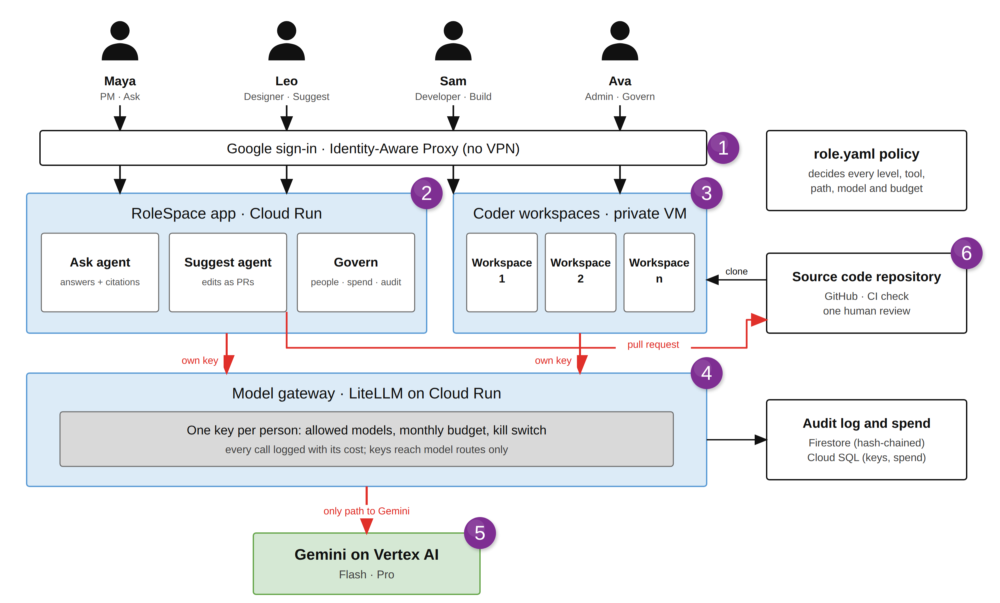
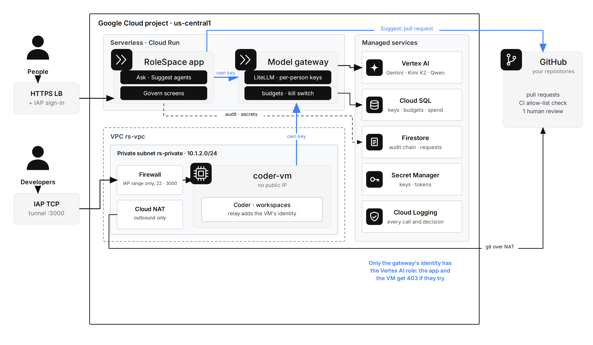
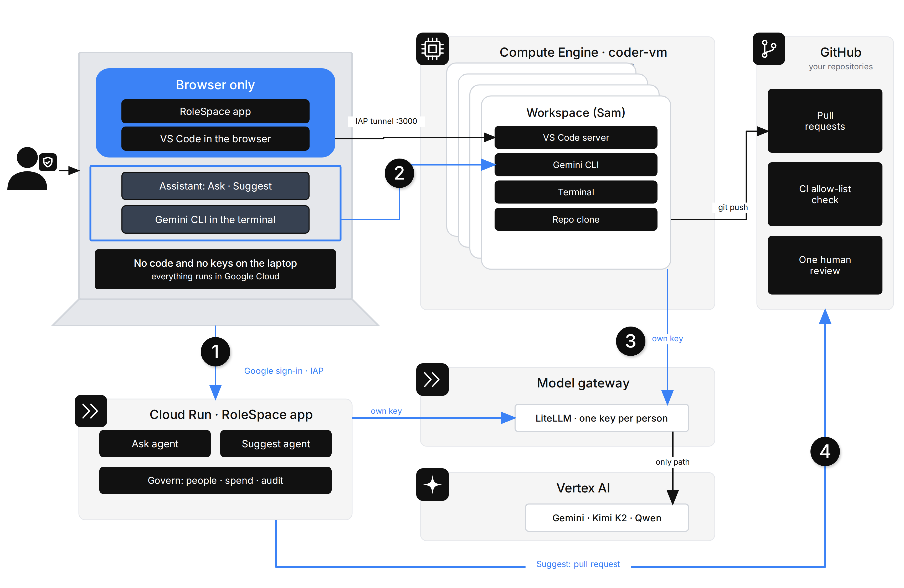
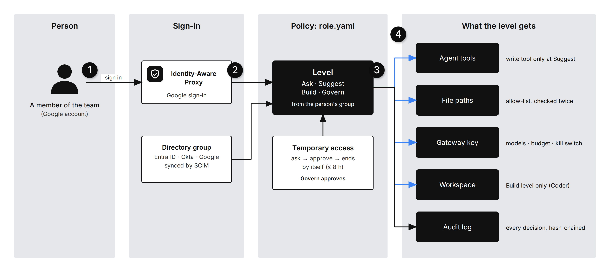

# RoleSpace

**Every role gets the right AI. The company keeps control.**

RoleSpace gives every person in a software company the right amount of AI for their job. One policy file, [`role.yaml`](role.yaml), gives each person a level. The level decides four things: which AI tools they get, which files they may change, which models they may call and how much they may spend. The rules are enforced in code, at the model gateway, in CI and in IAM, never by the prompt.

Built for the **AI Builder Cup 2026** (theme: *Future of Work & Enterprise Productivity*) on Google Cloud: Gemini on Vertex AI, the Agent Development Kit, Cloud Run and Identity-Aware Proxy.

| | |
|---|---|
| Website | https://rolespace.duckdns.org (public, interactive product tour; "Log in to your organization" leads to the app) |
| Live app | https://rolespace.duckdns.org/rolespace-ent/ (sign in with Google, then pick a persona) |
| Demo video (3 min) | https://www.youtube.com/watch?v=cTBwacNvkZc |
| Submission deck | [PDF](docs/deck/RoleSpace-AI-Builder-Cup-submission.pdf) · [PPTX](docs/deck/RoleSpace-AI-Builder-Cup-submission.pptx) · [design deck (PDF)](docs/deck/RoleSpace-deck.pdf) |



## Built on Google Cloud

- **Gemini on Vertex AI.** Every answer and every edit is a Gemini call (Gemini 3.8 Flash and 3.1 Pro). The Ask and Suggest agents are built with the Agent Development Kit (ADK) and reach Gemini through a LiteLLM model gateway, each on the person's own key. Only the gateway's service account may call Vertex AI. Kimi K2 and Qwen3 Coder from Model Garden go through the same gateway.
- **Cloud Run.** Runs the RoleSpace app (FastAPI and ADK), the LiteLLM model gateway, the public website, and the spending kill switch (`billing_cap/`).
- **Firestore (Firebase's database).** Holds the policy changes made in Govern, onboarded members, saved chats (deleted after 30 days by a TTL policy), access requests, temporary grants, the answer log, and the hash-chained audit log.

Every other Google Cloud service it uses is listed under [Google Cloud services](#google-cloud-services).

## The problem

- New hires take weeks to ship their first change.
- PMs and designers interrupt developers with "how does this work?" all week.
- AI tools are bought team by team. Developers get coding agents, everyone else gets nothing, and nobody sees the cost or the risk.

Giving everyone a coding agent is unsafe. Giving no one one wastes their time.

## Four levels

| Level | Who, in the demo | What they get |
|---|---|---|
| **Ask** | Maya, product manager | Questions about the code. Answers cite exact lines, and code checks every citation. No writes. A change she asks for becomes a request to the team that owns the code. |
| **Suggest** | Leo, product designer | Small edits inside a path allow-list (`public/css/**`, `public/**/*.html`). Each edit is a diff preview, then a pull request with a CI check and one human review. |
| **Build** | Sam, developer | A private Coder workspace with Gemini CLI on his own key. It's reached through an IAP tunnel, with no VPN and no public IP. |
| **Govern** | Ava, platform admin | Levels, budgets, approvals, a kill switch, spend per person, a hash-chained audit log, and a live architecture view. |

The demo codebase is [praveensaharan/firstround-demo](https://github.com/praveensaharan/firstround-demo). Everyone in `role.yaml` is made up.

## Architecture

How everything is laid out in the Google Cloud project:



Each piece in the project:
- **RoleSpace app and model gateway:** both run on Cloud Run.
- **Coder workspaces:** run on a VM in a private subnet with no public IP. Outbound traffic goes only through Cloud NAT, and inbound traffic comes only from Google's IAP range.
- **Gemini on Vertex AI:** only the gateway's service account may call it.
- **Managed services:** Cloud SQL holds keys and spend, Firestore holds the audit chain and requests, and Secret Manager holds every key and token.

How work moves, from a laptop to a pull request:



How a person's sign-in becomes what their level gets:



At enterprise scale (designed, not built), the same design grows: directory groups by SCIM, Coder on GKE, a highly available gateway with Model Armor, a VPC Service Controls perimeter, and a GitHub or GitLab app. [docs/enterprise-design.md](docs/enterprise-design.md) explains each step, and what is built now:


More design pages are in [docs/architecture](docs/architecture):
- the as-built architecture
- onboarding
- the role matrix
- the policy-check traces

## Where the policy is enforced

| Layer | What it stops |
|---|---|
| **Agent tools** (`agents.py`) | A level without a write tool can't write, whatever the prompt says. A `before_tool_callback` refuses any tool outside the level as well. |
| **Code checks** (`roles.py`, `main.py`) | Edits outside the allow-list are refused, including `..` tricks, and the check runs again at the moment of writing. A citation to lines the agent never read is struck out. Text in a file that is aimed at an AI is treated as data, and the attempt is logged. |
| **Model gateway** (LiteLLM on Cloud Run) | Each person has their own key, with its own model list, budget and kill switch. Keys can call models only, so a key can't mint new keys. |
| **CI, branch protection and IAM** | Bot PRs outside the allow-list fail CI, and a human must review before merge. Only the gateway's service account may call Vertex AI; a workspace calling Gemini directly gets 403. |

Every decision can explain itself. The person who was blocked sees each check in order, the rule that decided and the policy version, and admins can run the same checks as a simulator.

## Features

- **Verified answers.** Every `[file:line]` citation is checked against lines the agent really read, at a pinned commit.
- **Edits only as pull requests,** inside a path allow-list, with a diff preview, a CI check and one human review.
- **Private workspaces:** Coder plus Gemini CLI on each person's own key, reached through an IAP tunnel.
- **Per-person model keys:** models and budget per level, enforced by the gateway.
- **Temporary access:** a person asks for a higher level for a few hours, an admin approves, and it ends by itself.
- **Kill switch:** one click blocks a key, and the assistant, pull requests and workspace all stop at once.
- **Requests inbox:** a refusal becomes a tracked request to the owning team.
- **Explain every decision,** plus a policy simulator for admins.
- **Tamper-evident audit:** each event carries the hash of the one before. A one-click evidence pack (JSON or CSV) is mapped to SOC 2 and ISO 27001.
- **Govern screens:** overview, spend pace per person, impact numbers, and a live architecture view.

Enterprise controls:
- **Usage tracking:** tokens and cost per person, model, project and source (assistant or workspace), daily tokens per model, each person's budget and rate limits, and a CSV export.
- **Rate limits per level:** requests and tokens per minute on every key, next to the budget.
- **Model choice:** a model catalog in `role.yaml` (Gemini now; Claude on Vertex AI and OpenAI ready to switch on). Each level lists its models, and a person picks one of theirs in the assistant. Their key enforces the same list.
- **Onboarding:** an admin adds a person by work email, with their level, projects, models and budget. RoleSpace creates their key, stores it in Secret Manager and logs it. **Remove** blocks the key at once.
- **Changes:** RoleSpace opens the pull request under policy, in the person's name; CI and a human review decide what merges. The person follows it (checks, review, merged) on the Changes page.
- **Several repositories:** each project in `role.yaml` is a repository with its owning team. Only the projects marked for pull requests accept edits.
- **Repo access:** Govern → Repo access decides who can ask about and work on each repository. Every change goes into the audit log.
- **Issues & PRs:** open issues and recent pull requests, live from GitHub, for the repositories a person can access.
- **Policy form:** Govern → Policy changes each level's models, budget and rate limits without editing YAML, then pushes the change to every key.
- **Saved chats:** a History window reopens earlier chats, which are kept per browser for 30 days.
- **Workspaces per repository:** a Build workspace clones only the person's repositories, with VS Code and Gemini CLI for each, and opens in the Antigravity desktop IDE too.
- **Public website:** an interactive product tour at https://rolespace.duckdns.org, with "Log in to your organization" by work email.
- **Spending guardrails:** budgets and rate limits per key, one ceiling for all AI, and a project-wide hard stop (`billing_cap/`, in dry-run).

Screenshots are in [docs/screenshots](docs/screenshots).

## Results

Measured with [`eval/run_eval.py`](eval/run_eval.py) on 17 Oct 2026, against the code that is deployed, using the real gateway, Gemini and Coder VM. Details are in [eval/results.md](eval/results.md).

| | |
|---|---|
| Questions answered from the expected file | **10 / 10** |
| Citations verified (every cited line was read) | **92 / 92** |
| Median answer time | **12.2 s** |
| Attacks stopped, each by a named layer | **10 / 10** |
| Model cost of the whole run | **$0.13** |

These were the attacks:
- a planted prompt injection
- a PM asking for a code change
- a designer editing `server.mjs`
- path traversal
- going over budget
- asking for secrets
- calling a model that isn't on the key
- a key trying to mint itself a new key
- a workspace calling Vertex AI directly
- a bot PR outside the allow-list

The sample is small, and the checker proves where a citation points, not that the sentence is right.

## Google Cloud services

| Service | Used for |
|---|---|
| Gemini 3.8 Flash and 3.1 Pro on Vertex AI, plus Kimi K2 and Qwen3 Coder from Model Garden | All answers and edits, called only through the gateway |
| Agent Development Kit (ADK) 2.12 | The Ask and Suggest agents, one per request, with tools chosen by level |
| Cloud Run | The RoleSpace app (FastAPI), the LiteLLM model gateway, the public website and the spending kill switch |
| Cloud SQL (Postgres 16) | Gateway keys, budgets and spend |
| Firestore | Policy changes, members, saved chats, audit chain, requests, temporary grants, answer log |
| Secret Manager | Every key and token |
| Identity-Aware Proxy and an HTTPS load balancer | Google sign-in for the app, and the TCP tunnel to Coder |
| Compute Engine, VPC and Cloud NAT | The Coder VM in a private subnet with no public IP |
| Cloud Billing budgets and Pub/Sub | A project-wide spending cap that can switch billing off (`billing_cap/`) |

## Repository layout

```
main.py  agents.py  access.py  roles.py  services.py   the RoleSpace app (FastAPI + ADK)
role.yaml                                              the policy: levels, people, teams, elevation
static/                                                the web app (vanilla JS, strict CSP)
gateway/                                               LiteLLM config and image; provision_keys.py
coder/                                                 Coder VM setup, workspace image, template, relay
website/                                               the public website: static pages and a work-email → workspace lookup
billing_cap/                                           the project-wide spending kill switch (Cloud Run + Pub/Sub)
lb/                                                    the load balancer's routing: website at /, the app at /rolespace-ent/
tests/test_core.py                                     allow-list, explain, citations, audit chain
eval/                                                  evaluation script and results
docs/architecture/                                     flow diagrams and four high-level design pages
docs/deck/                                             submission deck (PPTX) and design deck (PDF)
docs/setup-gcp.md  docs/security.md                    how to deploy it; the security model
docs/enterprise-design.md                              usage, models, onboarding and merge requests at scale
```

## Run it

- **Locally,** with Google application-default credentials and an existing gateway:
  ```bash
  pip install -r requirements.txt
  ./snapshot_repo.sh                 # pins the demo codebase into ./repo
  python tests/test_core.py
  uvicorn main:app --port 8080       # then open http://localhost:8080/?as=maya
  ```
- **On Google Cloud:** follow [docs/setup-gcp.md](docs/setup-gcp.md) (project, gateway, network, Coder, app, sign-in).
- **Configuration:** the code uses the authors' project id and URLs as defaults; set `GOOGLE_CLOUD_PROJECT`, `GATEWAY_URL` and `GITHUB_REPO` for your own.

## Built, designed and next

- **Built:** everything above.
- **Designed, not built** (details in [docs/enterprise-design.md](docs/enterprise-design.md)):
  - levels from Entra ID or Okta groups through SAML and SCIM, with the person taken from IAP's signed header (the demo's personas stand in for them);
  - Model Armor in front of the model;
  - a VPC Service Controls perimeter and Cloud KMS keys;
  - Coder on GKE with a template per role;
  - a GitHub or GitLab app in place of the bot token;
  - usage in BigQuery and project budgets.
- **Next:**
  - policy changes through pull requests, with a preview of who gains or loses access;
  - Ask from Slack and Teams, with requests flowing into Jira or Linear;
  - cost per outcome;
  - a scoped admin key in place of the gateway's master key, and more than one app instance.

**Where RoleSpace fits:**
- Coding assistants license developer seats.
- AI gateways cap keys.
- Agent Gateway governs agents.

RoleSpace ties all three to a person's job, with one policy from a PM's question to a developer's workspace, and runs on Google's platform rather than against it.

## License

[MIT](LICENSE). The self-hosted fonts (Inter, JetBrains Mono) are under the SIL Open Font License.
