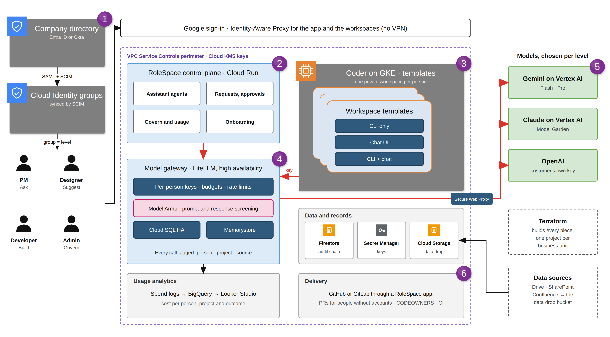

# RoleSpace for enterprises: usage, models, onboarding and merge requests

This page answers five questions a B2B buyer asks:
1. How is token use and cost tracked and limited?
2. What changes at enterprise scale?
3. Can someone open a merge request without a GitHub account?
4. Can a customer choose Claude, OpenAI or Gemini?
5. How does an admin onboard a new person?

Each section first says what the code in this repository does, then what is designed for a larger company. "Built" means it runs in this repository and is covered by tests or was tried end to end. "Designed" means it isn't built yet.

The prototype is the small version of this picture. It has the same levels, the same gateway with a key per person, and the same checks, but one Coder VM instead of GKE, and a persona menu instead of a company directory.

## 1. Token and usage tracking

**The rule:** every model call goes through the gateway on the caller's own key, so every call is counted and capped in one place. The app and the workspace VM have no Vertex AI role, so a direct call to Gemini gets a 403.

### Built

**Attribution:**
- **Person.** The gateway records which key made each call, and each key belongs to one person. People can't fake this.
- **Project, source and level.** The assistant tags every call with `project:…`, `source:app`, `level:…` and `person:…` in the `x-litellm-tags` header (`agents.py`). The gateway stores the tags in its spend log next to the tokens and the cost.
- **Untrusted tags.** RoleSpace reads tags as claims, not facts. A project tag counts only if the person works on that project; otherwise the call is "unattributed". Gemini CLI calls from a workspace are recognised by their API type.

**Govern → Usage** (`/api/govern/usage`) shows:
- totals for calls, tokens in and out, cost and failed calls;
- tokens per day, per model;
- a table per person: calls, tokens, cost, the models they used, budget used this period, rate limits, and whether they are suspended;
- breakdowns by model, by project, and by source (assistant or workspace);
- a CSV export (`/api/govern/usage.csv`), one row per call, for finance or a BI tool.

**Limits.** The gateway enforces these, so they hold even if the app is bypassed:

| Limit | Where it is set | What happens when it is hit |
|---|---|---|
| Models | the level in `role.yaml`, narrowed per person at onboarding | A call to any other model is refused |
| Budget | the level (or set per person), reset every `budget_period` (30 days) | Calls are refused until the reset or until an admin raises it |
| Requests and tokens per minute | `rpm_limit`, `tpm_limit` per level | A runaway loop is throttled; normal use isn't affected |
| Routes | every key | Keys can call models only, so a key can't mint new keys |
| Kill switch | Govern → People | The key is blocked; the assistant, pull requests and workspace all stop |

### Designed for scale

- **BigQuery.** A nightly job copies the gateway's spend table to BigQuery, through a Cloud SQL federated query or Datastream. Looker Studio then shows cost per person, project, cost centre and outcome (cost per answered question, per merged pull request).
- **Project budgets.** One gateway *team* per project, with its own budget, so a project can be capped as well as a person.
- **Alerts.** The gateway alerts when a person or team reaches 80% of its budget, through email or Slack.
- **Workspace tagging.** The workspace relay replaces any `x-litellm-tags` sent from inside the workspace with `source:workspace` and the workspace's project. Workspace calls then split by project as reliably as assistant calls.
- **Shared rate-limit counters.** Several gateway instances share their counters through Memorystore (Redis), so a limit holds across all of them.

## 2. Enterprise requirements: from the prototype to the target

| Area | Prototype (built) | Enterprise (designed) |
|---|---|---|
| **Identity** | Google sign-in through IAP; a persona menu picks who you are; admin writes need a passcode | Entra ID or Okta through SAML into Cloud Identity; groups synced by SCIM; group → level. The app takes the person from IAP's signed header (`x-goog-iap-jwt-assertion`), never from the request. This replaces the persona menu and the passcode. **It's the first thing to build before a real customer.** |
| **Workspaces** | One Coder VM in a private subnet; one template | Coder on GKE (or Cloud Workstations): one template per role (CLI only, chat UI, both), auto-stop when idle, a disk per person |
| **Gateway** | One LiteLLM service on Cloud Run with Cloud SQL | Two or more instances, Cloud SQL with high availability, Memorystore for shared counters. The app holds a scoped admin key instead of the master key |
| **Prompt safety** | Code checks, citation checks, prompt-injection logging | Plus Model Armor templates that screen prompts and responses at the gateway |
| **Data boundary** | Private subnet, no public IPs, only the gateway may call Vertex AI | A VPC Service Controls perimeter around Vertex AI, Firestore, Secret Manager and Cloud Storage. Customer-managed encryption keys in Cloud KMS. Calls to models outside Google Cloud leave through Secure Web Proxy |
| **Company data** | The code repository only | Drive, SharePoint and Confluence exports land in a Cloud Storage bucket, mounted read-only in workspaces or indexed for the assistant |
| **Audit** | Hash-chained events in Firestore; evidence pack mapped to SOC 2 and ISO 27001 | Also exported to a Cloud Logging bucket with a retention lock, and to BigQuery |
| **Deployment** | `deploy.sh` and documented `gcloud` steps | Terraform builds every piece, with one Google Cloud project per business unit (or per customer, for single-tenant installs) |

## 3. Merge requests without a GitHub account

### Built

Designers and PMs don't need GitHub accounts. Their changes still reach GitHub as normal pull requests:
1. The person asks for a change in the assistant. The edit must pass the path allow-list twice: when it is proposed and again when it is written.
2. They review the diff and click **Open pull request**.
3. RoleSpace opens the pull request with its own GitHub token. The commit's author and committer are the person (name and work email), because they reviewed the change and chose to open it. The commit carries no tool or AI trailer. The description says they have no GitHub account. The audit chain keeps the full record inside the company: who asked, when, and under which policy version.
4. CI checks the allow-list again, and branch protection requires one human review. The code owners, who do have GitHub accounts, review and merge as usual.
5. The **Changes** page (`/api/changes`) shows each pull request the person opened: its checks (passing, failing or pending), its review state, its comments, and whether it was merged. Govern sees everyone's.

People without a GitHub account can't push, merge or approve. The bot's token covers one repository and only Contents and Pull requests.

### Designed

- **A GitHub App instead of a token.** The app gets short-lived installation tokens scoped per repository, appears as `rolespace[bot]`, and is installed by the customer's GitHub admin.
- **Answering review comments from RoleSpace.** The person reads the reviewer's comments on the Changes page and asks the assistant to revise. The agent pushes a follow-up commit to the same branch, inside the same allow-list.
- **GitLab, Bitbucket and Azure DevOps.** The same flow through each one's merge-request API, for example GitLab's `POST /projects/:id/merge_requests` with a project access token. `open_pr` and `pr_status` in `services.py` are the only code that would change.

## 4. Choosing models: Gemini, Claude, OpenAI

### Built

- **Catalog.** `role.yaml` has a `models:` catalog. Each model has a label, a provider and a status:
  - `enabled`: the gateway serves it;
  - `available`: it needs a one-time step first, which the catalog's note describes.
- **Who gets which model.** Each level lists the models it may use. At onboarding the admin can narrow that list for one person.
- **Picking a model.** The assistant has a model picker that shows only the person's models. The server checks the choice again (`pick_model`) and falls back to the level's default. The person's gateway key holds the same list, so even a direct call with the key can't reach another model.
- **Where admins see it.** Govern → Policy shows the catalog, and Govern → Usage splits tokens and cost by model.

| Model | Status | How to switch it on |
|---|---|---|
| Gemini 3.8 Flash, Gemini 3.1 Pro | enabled | – |
| Claude Opus 5.5 (Anthropic on Vertex AI) | available | Enable Claude in Vertex AI Model Garden. Uncomment `claude-opus` in `gateway/config.yaml` (`vertex_ai/claude-opus-5-5`, location `global`) and add it to a level's `models`. Then run `gateway/provision_keys.py`. Billing goes through Google Cloud, and the gateway's service account is the only caller, as with Gemini. |
| OpenAI (for example a Codex model) | available | Store the customer's OpenAI API key as the secret `openai-api-key`, mounted on the gateway as `OPENAI_API_KEY`. Uncomment `openai-codex` in `gateway/config.yaml` with the model id. Prompts leave Google Cloud, so check data-residency rules first. |

**Before enabling a model for a level, re-run the evaluation with it.** Tool calling and citation quality vary between models.

### Designed

- **Other CLIs in workspaces.** Claude Code and Codex CLI can be pointed at the gateway with the person's own key, as Gemini CLI is today. The gateway serves both Anthropic-style and OpenAI-style APIs. The workspace template chooses the CLI by role.

## 5. Onboarding a new person

**Should there be an onboarding page? Yes.** It is built. For a small company it is the main way to add people. In a large company the directory is the main way, and the page handles exceptions such as contractors, and shows what the directory sync did.

### Built

**Govern → People → Add person** asks for:
- a work email, on the company's domain only;
- name, title and team;
- the level;
- the projects (each project is a repository and its owning team);
- the models, limited to what the level allows;
- a budget, up to $20.

As the admin fills it in, a plan shows exactly what will be created. On **Add**, RoleSpace:
1. checks the request (domain, duplicates, team, projects, that the models fit the level, the budget cap) and refuses it with reasons if anything is wrong;
2. creates the Secret Manager secret `gw-key-<id>` *before* any key exists, so a key is never minted that can't be stored;
3. creates a gateway user and a key named `<id>-<level>`. The key carries the chosen models, budget, budget period, rate limits, model-only routes, and team and project metadata;
4. stores the key in the secret. If that fails, it deletes the key again;
5. saves the person in Firestore (`members`) and writes `member_added` to the audit chain.

The person then appears everywhere straight away: People, Usage, the assistant with their models and projects, and explain-why.

**Remove** (offboarding) blocks the key at the gateway at once, marks the person removed, and writes `member_removed` to the audit chain. People listed in `role.yaml` are changed by editing `role.yaml`, which keeps it the reviewed base policy.

### Designed

- **Build-level workspaces.** Today onboarding marks the workspace "queued", and `coder/sync_build_keys.sh` hands the key to the VM. Next, a small provisioner on the VM watches for queued members. It creates the Coder user and a workspace from the role's template, then marks it ready.
- **Repository access per project.** The workspace gets a GitHub App installation token for the person's project repositories only, instead of one shared token.
- **Sign-in grant.** Onboarding adds the person, or more often their group, to the IAP access policy.
- **SCIM.** Directory group changes create, update and remove members automatically, and write the same audit events.

## Before turning these on in production

1. **Let the app create keys.** The app's service account can read secrets but can't create them. Grant it a custom role with `secretmanager.secrets.create` and `secretmanager.versions.add`, with an IAM condition that limits it to secrets named `gw-key-*`. The commands are in [setup-gcp.md](setup-gcp.md#onboarding-new-people). Without the grant, onboarding stops at the first step and creates nothing.
2. **Apply the rate limits to existing keys** by running `python gateway/provision_keys.py`.
3. **Enable Claude** in Model Garden, if the customer wants it (section 4).
4. **Before real customers, bind identity** to IAP's signed header (section 2). Until then the persona menu decides who you are, and the passcode protects admin changes.
